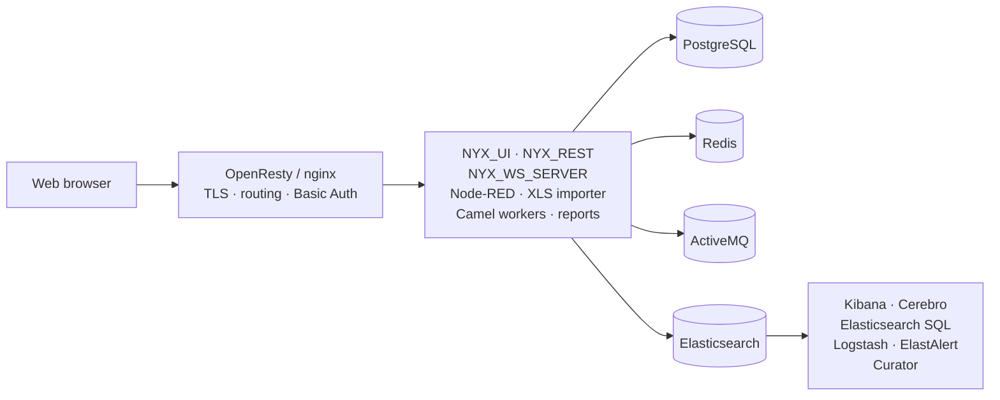

# NYX


**NYX is a self-hosted data platform for organizations that collect data in the field.**
It bundles the whole chain — form capture, ingestion, storage, analytics and reporting — into
one Docker Compose stack you can run on-premise or on your own cloud account. You focus on
functionality; the infrastructure (message broker, databases, reverse proxy, pipelines) is
already wired together.

```shell
git clone https://github.com/Indian-Runners/nyx.git
cd nyx/nyx/docker-compose      # host directories are needed first — see below
cp .env.example .env           # set PG_PASSWORD and AMQC_PASSWORD
docker compose up -d
```

Then open `https://localhost/`. The TLS pair is generated on the first start (self-signed, no
step of your own); full prerequisites, including the host directories, are in
[Getting started](#getting-started).

Every deployable state of the stack is tagged and documented in
**[Releases](https://github.com/Indian-Runners/nyx/releases)** — the pinned image versions, what
changed, and what did not move. See
[Tagging this repository](docs/operations.md#tagging-this-repository) for how a release is cut.


## Why NYX

- **Collect data where there is no reliable network.** Offline form capture, through the mobile client — **deprecated**, see the component list below.
- **Turn raw files into queryable data.** The XLS importer and Apache Camel workers clean, reshape and load incoming data automatically.
- **Answer questions without writing infrastructure.** Dashboards (Kibana, Grafana), Jupyter notebooks and Vega visualizations share the same data.
- **Ship paper reports on a schedule.** Jasper-based report runner generates PDF/XLS reports on a timer and stores them for download.
- **Know when something breaks.** ElastAlert rules, container monitoring and centralized logs keep watch over the platform.

## What is inside

| Capability | Components |
| --- | --- |
| Web interface | NYX_UI (Vue.js), served by OpenResty at `/` |
| REST API | NYX_REST (Python / gunicorn), Swagger UI at `/api/doc/` |
| Mobile app | NYX_MOB, served at `/mobile/` — **deprecated, not deployed** on the current instance |
| Field-data ingestion | NYX XLS importer, Apache Camel workers, Node-RED at `/nodered/` |
| Messaging | Apache ActiveMQ (STOMP + AMQC monitoring at `/amqc/`) |
| Structured data | PostgreSQL 11.4 |
| Analytics & search | Elasticsearch 7.2, Kibana 7.2 at `/kibana/`, Elasticsearch SQL plugin |
| Reporting | Report runner (Jasper), report scheduler, Grafana export |
| Data science | Jupyter / Anaconda at `/ipython/` |
| Logging & monitoring | Logstash, the console's log and file browser at `/logs/`, Curator, ElastAlert, Elasticsearch admin via Cerebro at `/cerebro/` |

## Architecture



Requests enter through nginx, which terminates TLS and routes to the UI, the REST API or one
of the panels. The API and the workers talk to PostgreSQL for transactional data, Redis for
sessions, ActiveMQ for asynchronous work, and Elasticsearch for analytics. Observability
components read from Elasticsearch and the shared log volume.

A more detailed, annotated file tree is in [folder_contents.md](folder_contents.md).

## Getting started

### Requirements

- A Linux host (or Docker Desktop) with **at least 8 GB of RAM** — Elasticsearch is memory hungry.
- Docker Engine and Docker Compose v2 (`docker compose version`).
- The following host directories, created from the `nyx/` folder (the one that contains
  `docker-compose/`) before the first start:

```shell
cd nyx                    # the folder that contains docker-compose/
mkdir -p logs generatedreports/rapi backup config_backup notebooks \
         node_red_data public_www reportrunnerold reportrunner/generated
```

No certificate step: the package ships none. The `certgen` service writes a self-signed pair into
`nyx/certs/` (git-ignored) the first time the stack starts, and leaves an existing pair alone —
set `NYX_HOST` to the name browsers will use. Replace the pair with a real certificate for
anything other than local use, see [`nyx/certs/README.md`](nyx/certs/README.md).

### Start the platform

```shell
cd nyx/docker-compose
cp .env.example .env      # then edit it
docker compose up -d
```

`.env` is git-ignored and **required**: the compose file refuses to start without
`PG_PASSWORD` and `AMQC_PASSWORD`. `GRAFANA_*` variables are optional and only needed for
Grafana dashboards and exports.

> **Before you deploy anywhere public**, review the host paths and credentials described in
> [Configuration](#configuration). This repository ships a working demo layout, not a
> production-hardened one.

### Check that it works

```shell
docker ps -a | grep -v Up     # should print nothing
curl -k https://localhost/api/v1/status
```

Then open `https://localhost/`. If nginx answers 404/503, it started before the API —
`docker restart nginx`. Full recovery steps: [troubleshooting.md](troubleshooting.md).

### Exposed entry points

| Path / port | Service |
| --- | --- |
| `/` | NYX web UI |
| `/api/`, `/api/doc/`, `/swagger.json` | REST API, its Swagger UI and its OpenAPI description |
| `/kibana/`, `/kibananyx/` | Kibana instances (classic and NYX-configured) |
| `/nodered/`, `/cerebro/`, `/amqc/`, `/ipython/`, `/logs/` | Node-RED, Cerebro, ActiveMQ console, Jupyter, the log and file browser |
| `/generatedreports/` | Generated report files |
| `5444` | PostgreSQL (container port 5432) |
| `61613`, `61614`, `61616` | ActiveMQ STOMP / SSL / OpenWire |
| `5801` | Kibana (direct, bypassing nginx) |

The Elasticsearch proxy on port `9200` and the Node-RED socket are protected by Basic Auth
(`/etc/nginx/conf.d/.htpasswd` inside the `nginx` container); the `auth_basic` lines in
`nyx/nginx/default.conf` enable it on the other routes.

## Configuration

| What | Where |
| --- | --- |
| Domain name | `server_name` in `nyx/nginx/default.conf` |
| TLS certificate and key | `nyx/certs/` — self-signed pair generated by `certgen` at first start, git-ignored; drop in your own pair to replace it (`NYX_HOST` sets its name) |
| Passwords, Grafana access | `nyx/docker-compose/.env` (from `.env.example`) |
| Services, images, ports, volumes | `nyx/docker-compose/docker-compose.yml` |
| Routes, Basic Auth, cache rules | `nyx/nginx/default.conf` |
| ETL routes | `nyx/camelworkers/camelworker1/config.xml` |
| Kibana configuration | `nyx/kibana/kibana*.yml` |

Configuration files are **bind-mounted**, so after editing one you restart the affected
container (`docker restart nginx`) — there is no image rebuild.

**Host paths to change before deploying.** Compose mounts four absolute paths that assume a
specific server layout:

| Path in `docker-compose.yml` | Used by |
| --- | --- |
| `/home/nyx/elkdata/esnodebal/data` | Elasticsearch data |
| `/home/nyxinstall/nyx/postgresqldata/data` | PostgreSQL data |
| `/home/nyxinstall/nyx/kibana/kibana/elastalert-kibana-plugin` | Kibana plugins |
| `/home/nyxinstall/nyx/kibana/kibana/TrafficLightVisKibana6` | Kibana plugins |

Every other volume is relative to `nyx/` and therefore works from a fresh clone.

## Security

This repository is a **deployment template with demo credentials**. Before running it on a
network you do not control:

- Generate new values for every password in `.env` and rotate the ones referenced by
  `nyx/camelworkers/`, `nyx/elastalert/` and `nyx/scripts/`.
- Replace the generated self-signed pair in `nyx/certs/` with a certificate you issued — the
  package ships none, so the one you find there was generated on this host.
- Add `.htpasswd` entries and enable `auth_basic` on the admin surfaces (Node-RED, Kibana,
  Cerebro, Elasticsearch).
- Do not expose ports `5444`, `61613`–`61616` or `9200` to the internet.

See [SECURITY.md](SECURITY.md) for how to report a vulnerability.

## Repository map

NYX is split into independent repositories; this one only holds deployment and configuration.

| Repository | Role |
| --- | --- |
| [nyx](https://github.com/Indian-Runners/nyx) *(this one)* | Docker Compose stack, nginx routing, service configuration, backup scripts |
| [nyx_ui](https://github.com/Indian-Runners/nyx_ui) | Web interface (Vue.js) — add your own screens here |
| [nyx_rest](https://github.com/Indian-Runners/nyx_rest) | REST API (Python) — add your own endpoints here |
| [nyx_containers](https://github.com/Indian-Runners/nyx_containers) | Container definitions used to ship, clean and process data |
| [nyx_mob](https://github.com/Indian-Runners/nyx_mob) | Mobile application for form capture — **deprecated and archived**, image frozen at `v1.0.2` (March 2020) |
| [nyx_ws_server](https://github.com/Indian-Runners/nyx_ws_server) | Dispatches ActiveMQ STOMP messages to web sockets |

Application images are built and tagged in those repositories and pulled here by tag, so
changing application behaviour usually means bumping an image tag in the compose file.

## Documentation

Start with the [documentation index](docs/README.md):

- [Architecture](docs/architecture.md) — services, ports, routes, volumes, known gaps
- [Broker contract](docs/broker-contract.md) — queues, topics, payloads
- [Data model](docs/data-model.md) — indices, screens (`nyx_app`), access rules, sessions
- [Signing in](docs/authentication.md) — password, Active Directory, GitHub, Entra ID: how each is configured, and who is let through
- [REST API](docs/api.md) — endpoints, authentication, exports, error codes
- [Operations](docs/operations.md) — health checks, upgrades, backups, security checklist
- [Running the platform locally](running_locally.md)
- [Troubleshooting](troubleshooting.md) — stopped containers, logs, disk pressure
- [Folder structure](folder_contents.md)

## Contributing

Issues and pull requests are welcome. Please open an issue describing the change before
submitting a large pull request, keep compose and nginx changes in sync (a new service needs
both a compose entry and a `location` block), and never commit real credentials.

## License

Released under the [BSD 2-Clause License](LICENSE).
