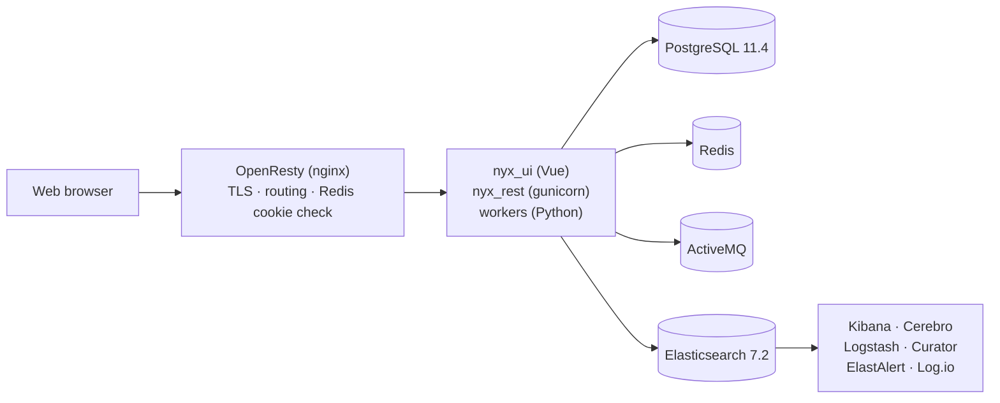

[Back](README.md)

# Architecture

## Runtime shape

Everything is behind one TLS endpoint. nginx (OpenResty) terminates TLS, routes by path, and
checks the per-tool session cookie against Redis before proxying anything administrative.

The API and the workers never talk to each other directly: every asynchronous interaction goes
through ActiveMQ (see [broker contract](broker-contract.md)).

## Services

Image tags live in `nyx/docker-compose/docker-compose.yml` — that file is the single source of
truth. This table names the repository and the role.

| Service (container) | Image repository | Role |
| --- | --- | --- |
| `nginx` | `openresty/openresty` | TLS, routing, Basic Auth, Redis cookie checks |
| `nyx_ui` | `snuids/nyx_ui` | Web console, served by a small express server on port 7654 |
| `nyx_restapi` | `snuids/nyx_rest` | REST API, gunicorn with 3 workers on port 8000 |
| `nyx_mobile` | `snuids/nyx_mobile` | Mobile front-end at `/mobile/` — **deprecated** (`nyx_mob` archived), not deployed on the current instance |
| `nyx_xlsimporter` | `snuids/nyx_xlsimport` | Consumes `FILE_UPLOAD_XLS`, loads spreadsheets into Elasticsearch |
| `nyx_lambda` | `snuids/nyx_lambda` | Runs the notebooks in `notebooks/Lambdas` on interval, message or cron |
| `nyx_reportrunner_1` | `snuids/nyx-reportrunner` | Renders reports (Jasper, Python, notebooks, Grafana exports) |
| `nyx_scheduler` | `snuids/nyx_reportscheduler` | Computes the next runs of the periodic reports |
| `nyx_rest_helper` | `snuids/nyx_rest_helper` | Executes the large exports and mails them |
| `camelworker1` | `engiecofely/camelworker` | Apache Camel ETL routes (`camelworkers/camelworker1/config.xml`) |
| `amqc` | `snuids/activemq-amqcmonitoring` | ActiveMQ broker + its monitoring console |
| `nodered` | `snuids/nodered` | Flows, report orchestration, spreadsheet upload UI |
| `curator` | `snuids/curator` | Index retention |
| `elastalertrest` | `bitsensor/elastalert` | Alerting (rules are not tracked, see below) |
| `monitordocker` | `snuids/monitordocker` | Container health and infrastructure metrics into Elasticsearch |
| `logioweb`, `harvester` | `blacklabelops/logio` | Live log UI over the shared `logs` volume |
| `kibana` | `elastic/kibana` 7.2 | Stock Kibana at `/kibana/` |
| `kibananyx` | `elastic/kibana` 7.2 | Kibana with the NYX dashboards at `/kibananyx/` |
| `cerebro` | `lmenezes/cerebro` | Elasticsearch cluster administration |
| `esnodebal` | `elastic/elasticsearch` 7.2 | The only Elasticsearch node that runs (`discovery.type: single-node`) |
| `logstash` | `elastic/logstash` 7.2 | Log pipeline (TCP 5001 + file inputs) |
| `anaconda` | `snuids/anaconda` | Jupyter at `/ipython/` |
| `redis` | `redis` | Sessions, per-tool cookies, transient state |
| `postgres` | `postgres` 11.4 | Relational storage for SQL-backed applications |

`esnode1`, `esnode2` and `esnode3` exist as configuration for a multi-node cluster but are
commented out in the compose file. Elasticsearch 7.2, Kibana 7.2 and PostgreSQL 11.4 are pinned
platform versions, not an oversight: upgrading them is a separate, planned operation.

## Host ports

Only a few are meant to be reachable from outside the Docker network:

| Port | Service | Notes |
| --- | --- | --- |
| 80, 443 | `nginx` | Redirect and the actual platform |
| 9200 | `nginx` → `esnodebal` | Elasticsearch, protected by Basic Auth; do not expose publicly |
| 5801 | `kibana` | Direct Kibana, bypasses nginx (no cookie check) |
| 5444 → 5432 | `postgres` | Database |
| 61613, 61614, 61616 | `amqc` | STOMP, STOMP over SSL, OpenWire |

The compose file also maps a set of legacy nginx ports (5701, 5702, 8080, 8162, 6601, 9000,
9001, 444, 61619). They come from older deployments; the platform only needs 80 and 443.

## Routes

`nyx/nginx/default.conf` is the routing table. Adding a service means adding both a compose
entry and a `location` block.

| Path | Target | Protection |
| --- | --- | --- |
| `/` | `nyx_ui` | session cookie checked by the UI itself |
| `/api/`, `/swagger.json`, `/swaggerui/` | `nyx_restapi` | token in the request (`?token=`), see [REST API](api.md) |
| `/kibana/`, `/kibananyx/` | `kibana`, `kibananyx` | Lua check of `nyx_kibana` / `nyx_tok` cookie in Redis |
| `/nodered/` | `nodered` | Lua check of `nyx_nodered` cookie, Basic Auth on the socket |
| `/cerebro/` | `cerebro` | Lua check of `nyx_cerebro` cookie |
| `/amqc/` | `amqc` | Lua check of `nyx_amqc` cookie |
| `/ipython/` | `anaconda` | Lua check of `nyx_anaconda` cookie |
| `/logs/` | `logioweb` | Lua check of `nyx_logs` cookie |
| `/generatedreports/` | static files | none (files are unguessable UUIDs) |
| `/temp/`, `/public/` | static files | none |

`/kibananyx/` has one extra job: it stores the body of every dashboard query in Redis
(`nyx_kib_msearch<token>`) so that `/api/v1/kibana_load` can export the data behind a Kibana
panel.

The Elasticsearch proxy on port 9200 and the Node-RED socket are additionally protected by
`auth_basic` with `/etc/nginx/conf.d/.htpasswd` inside the container. `kibana` on port 5801 is
**not** protected — do not publish it.

## Volumes

Runtime data is bind-mounted next to the repository, so a directory that does not exist yet is
created by Docker as `root`, which then breaks the workers. Create them before the first start
(see [Running locally](../running_locally.md)).

| Host path | Used by | Content |
| --- | --- | --- |
| `nyx/logs` | almost every container | per-service logs, also harvested by Log.io and Logstash |
| `nyx/generatedreports`, `.../rapi` | report runner, API, rest_helper | generated reports and exports, served at `/generatedreports/` |
| `nyx/backup`, `nyx/config_backup` | Camel worker, backup scripts | working directories for the ETL and the backups |
| `nyx/notebooks` | lambda, anaconda | notebooks, including `notebooks/Lambdas` |
| `nyx/node_red_data` | nodered | flows |
| `nyx/public_www` | nginx | static files at `/public/` |
| `nyx/reportrunner/jasper`, `.../pythondef`, `.../generated` | report runner | report definitions and output |
| `nyx/camelworkers/camelworker1` | camelworker1 | ETL route definition |

Four volumes use hardcoded absolute host paths and must be adapted to the machine:
`/home/nyx/elkdata/esnodebal/data`, `/home/nyxinstall/nyx/postgresqldata/data`, and the two
Kibana plugin directories.

## Request flow

1. The console logs in against `/api/v1/cred/login`. The API returns a token and one cookie per
   tool the user's privileges allow.
2. nginx lets the user into `/kibana/`, `/nodered/`, … only if the corresponding Redis key
   (`nyx_<tool>_<token>`) exists.
3. A screen is a document in the `nyx_app` index; the UI renders it with a generic component,
   so adding a screen does not require a UI release (see [data model](data-model.md)).
4. Reads and writes go to `/api/v1/generic_search` / `/api/v1/generic` (Elasticsearch) or
   `/api/v1/pg_search` / `/api/v1/pg_generic` (SQL). The API applies the index-level privileges
   and user filters before returning anything.
5. Exports above the inline threshold, and every report, are handed to the broker and delivered
   later (file, mail, or WebSocket notification).

## Known gaps

- **No `nyx_ws_server` service.** The console tries to open `/nyx_ui_websocket/`; the route does
  not exist in nginx, so live updates and the "report finished" notification added in
  report runner 1.9.24 are dropped. Adding it requires a compose service *and* an nginx location.
- **No Jasper service.** Since 1.9.x the report runner renders `jasper` and `jasper_jdbc`
  reports through the `nyx_jasper_creator` REST API (`JASPER_API`). The image is published but
  the container is not part of this stack.
- **ElastAlert rules are not tracked.** `elastalertrest` mounts `nyx/elastalert/rules/`,
  `alerts.py` and `elastalert.py`, which are absent from a fresh clone: the container will not
  start until they are provided or the service is commented out.
- **Node-RED flows are not tracked** (`node_red_data` is git-ignored), yet the report pipeline
  (STEP1 → STEP2 → STEP3) runs through them.
- `nyx/ELK/esnodebal/data/` contains a few tracked Elasticsearch node-state files even though
  `**/data/nodes/**` is ignored — they predate the ignore rule.
